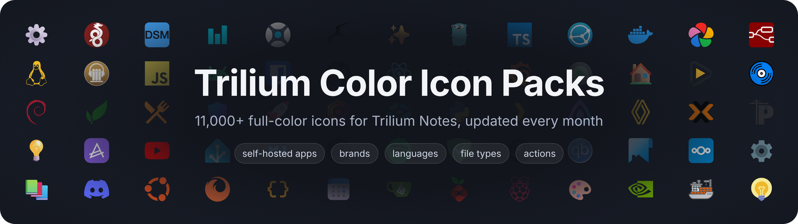
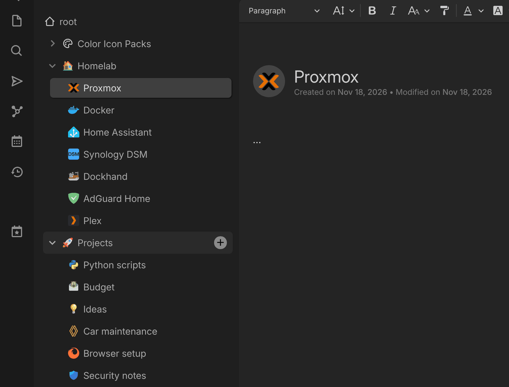
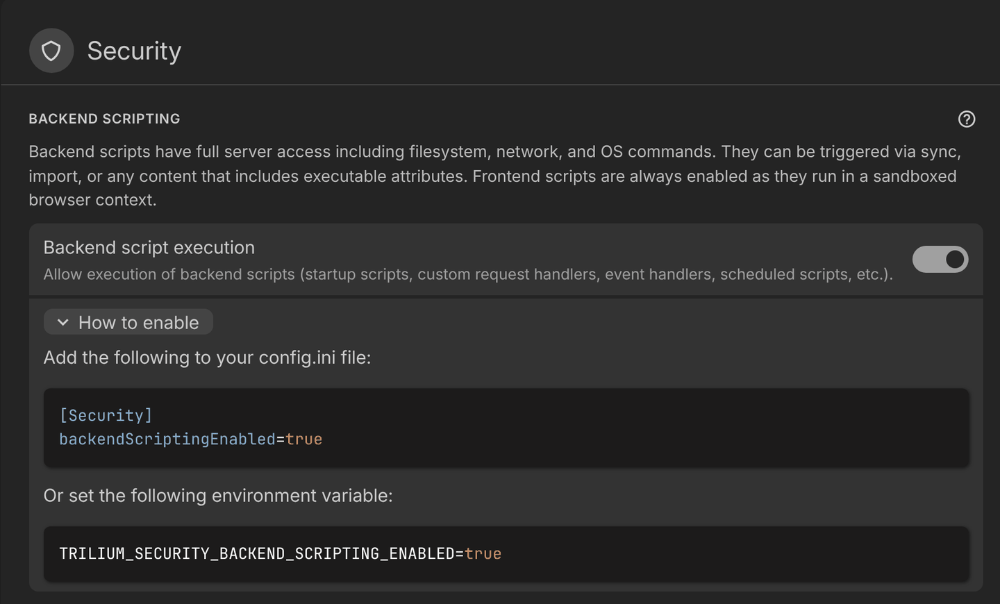
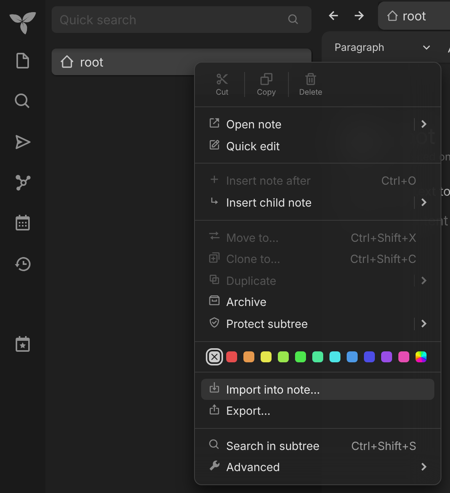
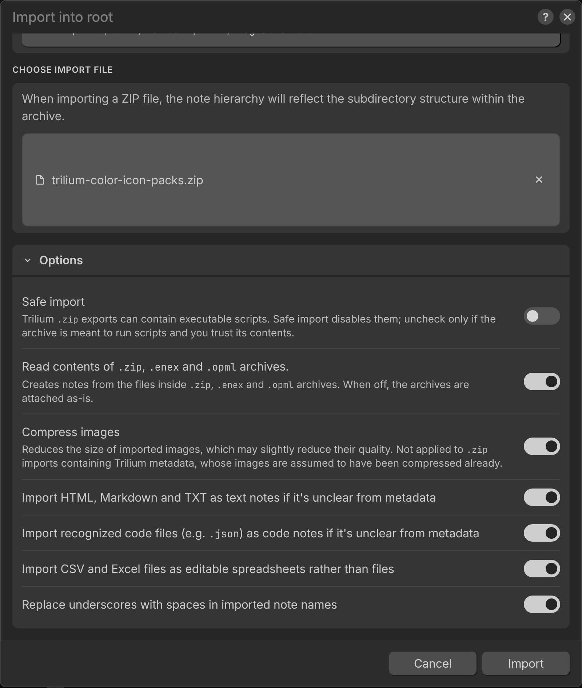
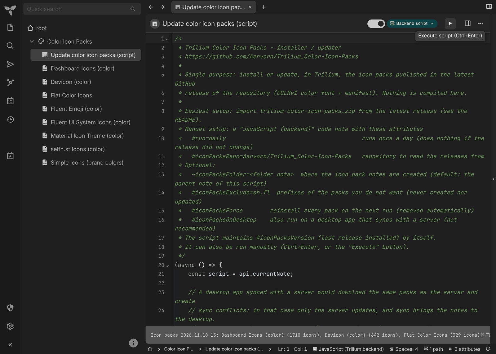
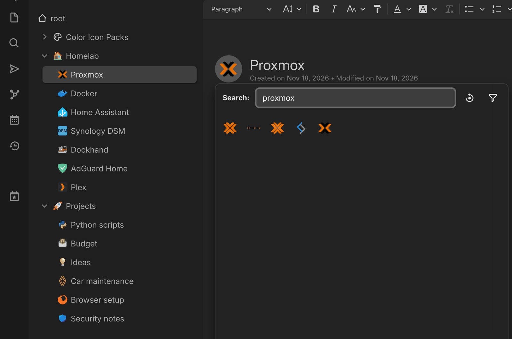

<p align="center"></p>

<p align="center"><a href="README.md">English</a> · <b>Français</b></p>

Packs d'icônes **en couleur** pour [Trilium Notes](https://github.com/TriliumNext/Trilium) (v0.102 ou plus), compilés chaque mois à partir de huit collections libres (plus un pack perso facultatif) : **plus de 11 300 icônes** pour les applications auto-hébergées, marques, langages de programmation, types de fichiers, actions et concepts du quotidien.

<p align="center"></p>

| Pack | Préfixe | Source | Contenu | Icônes* | Taille* | Licence |
| --- | --- | --- | --- | --- | --- | --- |
| selfh.st Icons | `sh` | [selfhst/icons](https://github.com/selfhst/icons) | Logos d'applications auto-hébergées et de services en ligne (Docker, Proxmox, Home Assistant, Plex, Nextcloud…) | 2 556 | 940 Ko | CC BY 4.0 |
| Devicon | `dev` | [devicons/devicon](https://github.com/devicons/devicon) | Langages, frameworks, outils de développement (Python, Git, Kubernetes, PostgreSQL…) | 642 | 334 Ko | MIT |
| Material Icon Theme | `mat` | [material-extensions/vscode-material-icon-theme](https://github.com/material-extensions/vscode-material-icon-theme) | Types de fichiers et dossiers, termes techniques (JSON, YAML, journaux, certificats, réglages…) | 910 | 120 Ko | MIT |
| Fluent Emoji | `fl` | [microsoft/fluentui-emoji](https://github.com/microsoft/fluentui-emoji) (style « Color ») | Actions et concepts (fusée, engrenage, cadenas, calendrier, alerte, coche…) | 1 568 | 1,4 Mo | MIT |
| Dashboard Icons | `di` | [homarr-labs/dashboard-icons](https://github.com/homarr-labs/dashboard-icons) | Autres applications auto-hébergées, matériel et services, **uniquement ceux absents de selfh.st** (Synology DSM, TrueNAS, Dockhand…) | 1 710 | 1,3 Mo | Apache 2.0 |
| Simple Icons | `si` | [simple-icons/simple-icons](https://github.com/simple-icons/simple-icons) | Logos de marques dans leur couleur officielle : constructeurs auto, navigateurs, banques, matériel, sites web (Renault, Firefox, Intel…) | 3 471 | 798 Ko | CC0 1.0 |
| Flat Color Icons | `fc` | [icons8/flat-color-icons](https://github.com/icons8/flat-color-icons) | Icônes plates génériques : bureau, finance, graphiques, appareils (réglages, histogramme, virement…) | 329 | 40 Ko | MIT |
| Fluent UI System Icons | `fs` | [microsoft/fluentui-system-icons](https://github.com/microsoft/fluentui-system-icons) (variantes `_color`) | Symboles d'interface en couleur (bouclier, calendrier, bâtiment, robot, alerte…) | 199 | 38 Ko | MIT |
| Extra Icons | `ex` | dossier [`custom/`](custom/) de ce dépôt | Icônes ajoutées à la main pour ce qu'aucune collection ne fournit. Vide par défaut : le pack n'existe que si le dossier contient des icônes | – | – | selon l'icône |

\* Release de novembre 2026. Les chiffres suivent les sources et changent d'une release à l'autre.

<a id="sommaire"></a>

##  Sommaire

- [Pourquoi ce projet](#pourquoi-ce-projet)
- [Prérequis et limites](#prérequis-et-limites)
- [Installation](#installation)
  - [Option A : installation et mises à jour automatiques (recommandé)](#option-a--installation-et-mises-à-jour-automatiques-recommandé)
  - [Option B : archive hors ligne](#option-b--archive-hors-ligne)
  - [Option C : un pack à la fois, à la main](#option-c--un-pack-à-la-fois-à-la-main)
- [Utiliser les icônes](#utiliser-les-icônes)
- [Mises à jour](#mises-à-jour)
- [Dépannage](#dépannage)
- [Désinstallation](#désinstallation)
- [Fonctionnement](#fonctionnement)
- [Demander ou ajouter des icônes](#demander-ou-ajouter-des-icônes)
- [Compiler en local, forker, ajouter une source](#compiler-en-local-forker-ajouter-une-source)
- [Licences et crédits](#licences-et-crédits)

<a id="pourquoi-ce-projet"></a>

##  Pourquoi ce projet

Depuis la v0.102, Trilium accepte des packs d'icônes personnalisés (voir *Icon Packs* dans l'aide intégrée de Trilium), mais uniquement sous forme de **polices** (`woff2`, `woff`, `ttf`). Une police d'icônes est normalement d'une seule couleur, et Trilium n'accepte ni fichiers SVG ni images comme icônes.

Ce projet compile les SVG de chaque collection en une **police couleur COLRv1** avec [nanoemoji](https://github.com/googlefonts/nanoemoji) (Google). Une police COLRv1 est un fichier `woff2` ordinaire : Trilium la charge par son mécanisme officiel de packs d'icônes. Les icônes apparaissent dans le sélecteur d'icônes, avec la recherche et le filtre par pack, dans l'arbre des notes, les onglets et les en-têtes, et peuvent être insérées dans les notes texte.

Les anciennes méthodes (classes CSS avec `background-image`, comme dans la [discussion #4604](https://github.com/orgs/TriliumNext/discussions/4604)) n'apparaissent pas dans le sélecteur et ont cassé avec la v0.102.

<a id="prérequis-et-limites"></a>

##  Prérequis et limites

- **Trilium v0.102 ou plus** (prise en charge des packs d'icônes personnalisés).
- **Le rendu en couleur dépend du client.** COLRv1 est pris en charge par les navigateurs basés sur Chromium (app de bureau Trilium, Chrome, Edge, Opera, Brave…) et par Firefox. **Safari ne prend pas en charge COLRv1** : dans Trilium ouvert dans Safari (macOS, iPhone, iPad), ces icônes n'apparaissent pas.
- **Option A** (mises à jour automatiques) : il faut que les **scripts backend soient activés** (désactivés par défaut depuis Trilium v0.104, voir [Installation](#option-a--installation-et-mises-à-jour-automatiques-recommandé)), et que la machine qui exécute le script (ton serveur Trilium, ou une app de bureau autonome) puisse joindre `github.com` en HTTPS. L'option B n'a besoin ni de l'un ni de l'autre.
- **Logos sombres sur thème sombre :** certains logos sont noirs (GitHub, Bash, Apple…) et peu lisibles sur un thème sombre. Ils sont dessinés exactement comme dans leur source.
- **Icônes ignorées :** quelques SVG ne peuvent pas être convertis en police (masques, dégradés hors limites, tracés invalides après découpe). Ils sont écartés et listés dans `<préfixe>.skipped.txt` de chaque release (environ 1 % des icônes, environ 10 % pour Dashboard Icons).
- **Simple Icons en une couleur :** les logos Simple Icons sont dessinés dans la couleur officielle de la marque. Quand cette couleur est presque noire ou presque blanche (Apple, GitHub, Uber…), le logo prend à la place la **couleur du texte de ton thème**, pour rester lisible en thème clair comme sombre.
- **Dashboard Icons en complément :** pour éviter les doublons, le pack `di` ne contient que les icônes que selfh.st ne fournit pas en SVG. Les variantes claire/sombre sont écartées quand l'icône de base existe.
- **Taille :** l'ensemble des polices pèse environ 5 Mo et sont chargées par chaque client. Pour n'avoir que certains packs, exclure les autres (`#iconPacksExclude`, option A) ou supprimer les notes des autres (option B).

<a id="installation"></a>

##  Installation

Chaque release contient deux archives Trilium. En choisir une :

| Archive | Ce qu'on obtient | Ce qu'il faut |
| --- | --- | --- |
| [`trilium-color-icon-packs.zip`](https://github.com/Aervorn/Trilium_Color-Icon-Packs/releases/latest/download/trilium-color-icon-packs.zip) (**option A**, recommandée) | Un dossier *Color Icon Packs* avec un petit script qui installe les packs, puis les met à jour une fois par jour | Scripts backend activés, et `github.com` joignable depuis le serveur Trilium |
| [`trilium-color-icon-packs-offline.zip`](https://github.com/Aervorn/Trilium_Color-Icon-Packs/releases/latest/download/trilium-color-icon-packs-offline.zip) (**option B**) | Un dossier *Color Icon Packs (offline)* avec tous les packs, prêts à l'emploi (~5 Mo) | Rien. Pas de mise à jour automatique : importer une archive plus récente quand on veut les nouveautés |

> [!IMPORTANT]
> Dans la fenêtre d'import, **décocher *Importation sécurisée* (*Safe import*)**. Elle désactive les labels qui exécutent du code ou chargent des polices (`#run`, `#iconPack`), qui resteraient inactifs en `#disabled:run` / `#disabled:iconPack`. Si c'est déjà arrivé, renommer ces labels en `#run` / `#iconPack`, ou supprimer le dossier et réimporter.

### Option A : installation et mises à jour automatiques (recommandé)

**1. Activer les scripts backend** (une fois). Depuis Trilium v0.104, ils sont désactivés par défaut, et le script de mise à jour est un script backend ([doc de Trilium](https://docs.triliumnotes.org/user-guide/scripts/Security)). Il faut les activer **là où le script tourne** : sur ton serveur si tu en as un, sinon dans ton app de bureau.

- **App de bureau sans serveur de synchronisation :** *Options → Sécurité → Exécuter les scripts backend*, puis redémarrer l'app.
- **Serveur** (Docker ou non) : l'interrupteur ne peut pas être changé depuis l'interface web. *Options → Sécurité → Comment activer* indique quoi faire :
  - Docker : ajouter la variable d'environnement `TRILIUM_SECURITY_BACKEND_SCRIPTING_ENABLED=true` au container, puis le recréer.
  - Sinon : ajouter `backendScriptingEnabled=true` sous `[Security]` dans `config.ini` (dossier de données de Trilium), puis redémarrer Trilium.

  

**2. Télécharger** [`trilium-color-icon-packs.zip`](https://github.com/Aervorn/Trilium_Color-Icon-Packs/releases/latest/download/trilium-color-icon-packs.zip) (environ 3 Ko : c'est le script qui télécharge les packs).

**3. L'importer.** Avec un serveur de synchronisation, le faire dans l'**interface web du serveur**.


- Clic droit sur la note sous laquelle placer le dossier (`root` convient) → **Importer dans la note…**

  
- Déposer l'archive dans la fenêtre, ouvrir **Options**, **décocher *Importation sécurisée* (*Safe import*)**, puis cliquer sur **Importer**.

  

**4. Lancer le script une fois.** Ouvrir *Color Icon Packs → Update color icon packs (script)* et cliquer sur **▶ Exécuter le script** en haut à droite (ou **Ctrl+Entrée**), là aussi dans l'**interface web du serveur**. Après quelques secondes, les huit packs apparaissent dans le dossier, et un message en bas liste ce qui a été installé.



**5. Rafraîchir Trilium** (**Ctrl+R**, ou *Recharger l'interface* dans le menu). Les icônes sont dans le sélecteur d'icônes (voir [Utiliser les icônes](#utiliser-les-icônes)), et le script les tient à jour tout seul, une fois par jour (`#run=daily`).

*Captures d'écran prises avec l'interface en anglais.*

Remarques :
- **Avec un serveur de synchronisation**, le script ne s'exécute **que sur le serveur**. Les apps de bureau synchronisées avec un serveur l'ignorent (pour éviter les conflits de synchronisation) et reçoivent les packs par la synchro. Ajouter `#iconPacksOnDesktop` à la note du script pour le forcer à tourner aussi sur les apps de bureau (déconseillé).
- **App de bureau autonome** (sans serveur de synchronisation) : le script tourne normalement dans l'app de bureau.
- **Seulement certains packs :** ajouter `#iconPacksExclude=<préfixes>` à la note du script, par exemple `#iconPacksExclude=si,fc,fs` pour se passer de Simple Icons, Flat Color Icons et Fluent UI System Icons. Les packs exclus ne sont jamais créés ni mis à jour.
- **Un autre dossier pour les packs :** ajouter la relation `~iconPacksFolder=<note dossier>` à la note du script. Sans elle, les packs sont créés dans la note parente du script.
- **De l'option B à l'option A :** importer l'archive de l'option A et lancer son script. Il reprend les packs de l'archive hors ligne (où qu'ils soient) et les met à jour sur place.
- **Installer le script à la main** plutôt qu'importer l'archive : créer une note de type **Code**, langage **JavaScript (backend)**, y coller [`trilium/update-icon-packs.js`](trilium/update-icon-packs.js), ajouter les labels `#run=daily` et `#iconPacksRepo=Aervorn/Trilium_Color-Icon-Packs`, puis reprendre à l'étape 4. Si la note a été créée par un assistant IA via le serveur MCP de Trilium, `#run` est enregistré en `#disabled:run` : l'activer avec l'interrupteur à côté du badge, près du titre de la note.

### Option B : archive hors ligne

1. **Télécharger** [`trilium-color-icon-packs-offline.zip`](https://github.com/Aervorn/Trilium_Color-Icon-Packs/releases/latest/download/trilium-color-icon-packs-offline.zip).
2. Dans Trilium, **clic droit sur une note** → **Importer dans la note** → choisir l'archive, **décocher *Importation sécurisée*** → *Importer* (même fenêtre que l'[option A, étape 3](#option-a--installation-et-mises-à-jour-automatiques-recommandé)).
3. **Rafraîchir Trilium** (**Ctrl+R**).

Pour ne garder que certains packs, supprimer les notes des autres. Pour mettre à jour, supprimer le dossier *Color Icon Packs (offline)* et importer l'archive d'une release plus récente.

### Option C : un pack à la fois, à la main

La procédure standard de Trilium (voir *Creating an icon pack* dans l'aide intégrée), utile pour un pack compilé soi-même.

1. Ouvrir la [dernière release](https://github.com/Aervorn/Trilium_Color-Icon-Packs/releases/latest) et télécharger, pour chaque pack voulu, `<préfixe>.manifest.json` et `<préfixe>.woff2` (préfixes : `sh`, `dev`, `mat`, `fl`, `di`, `si`, `fc`, `fs`, et `ex` s'il existe).
2. Dans Trilium, créer une note de type **Code**, langage **JSON**, avec le nom du pack comme titre (par exemple `Fluent Emoji (color)`). Ce titre s'affiche dans le filtre du sélecteur d'icônes.
3. Coller le contenu de `<préfixe>.manifest.json` dans la note.
4. Ouvrir les **pièces jointes** de la note et y envoyer `<préfixe>.woff2`. Vérifier que la pièce jointe a le type MIME `font/woff2` et le rôle `file`.
5. Ajouter le label `#iconPack=<préfixe>` à la note (par exemple `#iconPack=fl`).
6. Rafraîchir Trilium (**Ctrl+R**).

Pour mettre un pack à jour plus tard : remplacer le contenu de la note par le nouveau manifeste et la pièce jointe par la nouvelle police, puis rafraîchir.

<a id="utiliser-les-icônes"></a>

##  Utiliser les icônes



- **Sélecteur d'icônes :** cliquer sur l'icône d'une note → taper un mot dans la recherche. Le bouton **filtre** à côté de la recherche n'affiche qu'un pack. Chaque icône se trouve par son nom et par les mots-clés de sa source (catégories et tags de selfh.st, tags et noms alternatifs de Devicon, mots-clés de Fluent Emoji, alias et catégories de Dashboard Icons, noms et alias de marques de Simple Icons, métaphores de Fluent UI System Icons). Les mots-clés sont en anglais, la recherche ne tient pas compte des majuscules (voir la remarque ci-dessous).
- **Par label :** `#iconClass="<préfixe> <préfixe>-<nom>"`, par exemple :
  ```
  #iconClass="sh sh-docker"
  #iconClass="dev dev-python"
  #iconClass="mat mat-json"
  #iconClass="fl fl-rocket"
  #iconClass="di di-synology-dsm"
  #iconClass="si si-firefox"
  #iconClass="fc fc-bar-chart"
  #iconClass="fs fs-shield"
  ```
  Le label peut être héritable (`#iconClass(inheritable)=...`) pour donner la même icône à toute une branche, comme pour n'importe quelle icône de Trilium.
- **Dans les notes texte :** le bouton *Insérer une icône* de la barre de mise en forme fonctionne aussi avec ces packs. Les polices couleur ignorent la couleur du texte.
- **Noms des icônes :**

  | Pack | Règle | Exemples |
  | --- | --- | --- |
  | `sh` | `sh-` + la référence selfh.st (nom du fichier SVG) | `sh-home-assistant`, `sh-adguard-home`, `sh-paperless-ngx` |
  | `dev` | `dev-` + le nom Devicon ; la variante couleur `original` est utilisée, sinon `plain` | `dev-postgresql`, `dev-nodejs`, `dev-kubernetes` |
  | `mat` | `mat-` + le nom du fichier Material Icon Theme | `mat-folder-docker`, `mat-certificate`, `mat-console` |
  | `fl` | `fl-` + le nom Fluent Emoji, en minuscules, espaces remplacés par `-` | `fl-light-bulb`, `fl-check-mark-button`, `fl-hammer-and-wrench` |
  | `di` | `di-` + le nom du fichier Dashboard Icons (suffixe `-svg` retiré) | `di-synology-dsm`, `di-truenas`, `di-dockhand` |
  | `si` | `si-` + le slug Simple Icons (nom de la marque, minuscules, lettres et chiffres uniquement) | `si-renault`, `si-googlechrome`, `si-nvidia` |
  | `fc` | `fc-` + le nom du fichier Flat Color Icons, `_` remplacés par `-` | `fc-settings`, `fc-bar-chart`, `fc-money-transfer` |
  | `fs` | `fs-` + le nom Fluent UI System Icons, sans taille ni suffixe `_color`, `_` remplacés par `-` | `fs-shield`, `fs-calendar`, `fs-building-home` |
  | `ex` | `ex-` + le nom du fichier SVG dans `custom/` | `ex-remarkable` |

  La liste complète d'un pack est son manifeste (`<préfixe>.manifest.json` dans la release). Les noms ne dépendent que des sources : une icône garde son nom d'une release à l'autre. Une icône supprimée ou renommée par sa source disparaît, et les notes qui l'utilisaient n'ont plus d'icône.

- **Recherche et majuscules (bug de Trilium) :** Trilium met ce que tu tapes en minuscules mais le compare aux mots-clés d'un pack **tels qu'ils sont écrits** : un mot-clé écrit `Proxmox` n'est donc jamais trouvé. Depuis la release `2026.11.17-9`, chaque mot-clé de ces packs existe aussi en minuscules, ce qui contourne le bug : si une recherche ne trouve rien, commence par mettre à jour les packs. Le même bug touche tous les autres packs d'icônes perso dont les mots-clés ont des majuscules ; un correctif a été proposé à Trilium ([TriliumNext/Trilium#12691](https://github.com/TriliumNext/Trilium/pull/12691)).

<a id="mises-à-jour"></a>

##  Mises à jour

- **Releases :** un workflow GitHub Actions tourne le **1er de chaque mois** (03:23 UTC). Il ne publie une nouvelle release que si au moins une des sources a changé depuis la précédente.
- **Option A :** le script tourne une fois par jour. Quand la dernière release a une nouvelle version, il télécharge les packs, vérifie leurs empreintes SHA-256 par rapport à `release.json`, ne met à jour que les packs modifiés et enregistre la version installée dans `#iconPacksVersion`. **Rafraîchir Trilium** ensuite pour charger les nouvelles polices.
- **Forcer une réinstallation :** ajouter `#iconPacksForce` à la note du script et l'exécuter (le label est retiré ensuite).
- **Les push** sur les scripts de compilation, sur le script Trilium ou sur les SVG de `custom/` publient aussi une nouvelle release.
- **Options B et C :** consulter les [releases](https://github.com/Aervorn/Trilium_Color-Icon-Packs/releases) de temps en temps, et importer la nouvelle archive hors ligne (ou refaire les étapes manuelles).

<a id="dépannage"></a>

##  Dépannage

| Symptôme | À vérifier |
| --- | --- |
| Les packs n'apparaissent pas dans le sélecteur | Rafraîchir Trilium (**Ctrl+R**). Vérifier que chaque note de pack a le label `#iconPack` et une pièce jointe `font/woff2` de rôle `file`. Trilium ignore les notes protégées. Consulter le journal du backend (accessible depuis le menu principal, ou dans le dossier `log` du répertoire de données de Trilium). |
| Icônes absentes ou carrés vides | Probablement Safari (pas de COLRv1). Essayer l'app de bureau, Chrome ou Firefox. |
| `Backend script execution is disabled` au lancement du script | Les scripts backend sont désactivés (par défaut depuis Trilium v0.104) : les activer, voir [option A](#option-a--installation-et-mises-à-jour-automatiques-recommandé), étape 1. |
| Après un import, les labels s'affichent en `#disabled:run` ou `#disabled:iconPack` | *Importation sécurisée* est restée cochée. Renommer les labels en `#run` / `#iconPack`, ou supprimer le dossier et réimporter en décochant *Importation sécurisée*. |
| Journal : `Incomplete setup` | Il manque `#iconPacksRepo` sur la note du script. |
| Journal : `Cannot read the latest release` | La machine qui fait tourner Trilium ne joint pas GitHub (pare-feu, proxy, DNS), ou le nom du dépôt dans `#iconPacksRepo` est faux. |
| Journal : `Desktop app synced with a server` | Normal sur une app de bureau synchronisée : c'est le serveur qui met à jour. Si aucun serveur n'exécute le script, ajouter `#iconPacksOnDesktop`. |
| Journal : `Prefix "xx" is already used by …` | Un autre pack utilise déjà ce préfixe. Le script n'écrase jamais un pack qu'il n'a pas créé : changer le préfixe de l'autre pack, ou le supprimer. |
| Journal : `SHA-256 does not match` | Téléchargement corrompu ou interrompu. Rien n'a été modifié ; le script réessaie à sa prochaine exécution. |
| Journal : `Icon packs already up to date` | Rien à faire. Ajouter `#iconPacksForce` pour réinstaller quand même. |
| Le script ne tourne jamais tout seul | Vérifier que la note a `#run=daily` (et pas `#disabled:run`), que son langage est *JavaScript (backend)* et que Trilium n'est pas en mode sans échec (`TRILIUM_SAFE_MODE`). |
| Une recherche ne trouve rien alors que l'icône est dans le manifeste | Mettre à jour les packs (release `2026.11.17-9` ou plus récente, voir *Recherche et majuscules* ci-dessus), puis rafraîchir Trilium. |
| Une application a une icône sur le site de la source, mais pas dans le pack | Certaines icônes ne peuvent pas être converties : selfh.st ne propose certaines applications qu'en PNG (JDownloader, par exemple), et certains SVG de Dashboard Icons ne font qu'envelopper une image bitmap. Chercher le nom dans `<préfixe>.skipped.txt` de la release, puis [demander l'icône](#demander-ou-ajouter-des-icônes). À noter : `di` écarte les icônes que selfh.st fournit déjà en SVG. |
| Icônes absentes des notes partagées | Pour la fonction de partage, les notes des packs doivent aussi être partagées. |

<a id="désinstallation"></a>

##  Désinstallation

1. Retrouver les notes qui utilisent ces icônes : rechercher `#iconClass =* "sh "` (et de même avec `dev `, `mat `, `fl `, `di `, `si `, `fc `, `fs `, `ex `), puis changer ou retirer leur icône, par exemple avec les *actions groupées* des résultats de recherche.
2. Supprimer le dossier *Color Icon Packs* (ou, pour une installation manuelle, les notes portant le label `#iconPacksManaged` et la note du script), puis rafraîchir Trilium.

Pour ne retirer que certains packs avec l'option A, ajouter leurs préfixes à `#iconPacksExclude` sur la note du script **avant** de supprimer leurs notes. Sinon, le script recrée tout pack manquant à la release suivante.

<a id="fonctionnement"></a>

##  Fonctionnement

```
GitHub Actions (le 1er du mois)                        Trilium (une fois par jour)
 source_revisions.sh  une source a changé ?             update-icon-packs.js
 fetch_sources.sh     clone partiel des SVG              ├─ lit releases/latest/download/release.json
 build_pack.py        police COLRv1 + manifeste          ├─ nouvelle version ? télécharge police + manifeste
 package_release.py   release.json + empreintes          ├─ vérifie les SHA-256
 build_import_zips.py les deux archives d'import Trilium   └─ crée / met à jour les notes #iconPack
 gh release create
```

- **Un job par source**, en parallèle (d'environ 1 minute pour Fluent UI System Icons à environ 50 minutes pour Dashboard Icons).
- **`build_pack.py`** rassemble les SVG et leurs termes de recherche, les valide avec picosvg, attribue à chaque icône un point de code de la zone d'usage privé supplémentaire A (U+F0000 et suivants), compile la police avec nanoemoji (`glyf_colr_1`, 1024 unités par em, glyphes carrés) et la convertit en `woff2`. Avant cela, chaque SVG est nettoyé : règles CSS `<style>` intégrées, unités `px` et couleur `transparent` retirées, viewBox complétée en carré pour que les logos larges restent centrés. Quand nanoemoji échoue sur des icônes, le script repère toutes les fautives en une passe, les écarte et relance.
- **Fichiers de release**, pour chaque pack : `<préfixe>.woff2`, `<préfixe>.manifest.json` (manifeste Trilium), `<préfixe>.skipped.txt`. Les deux archives d'import `trilium-color-icon-packs.zip` et `trilium-color-icon-packs-offline.zip`, au format d'un export Trilium (`!!!meta.json`), produites par `build_import_zips.py`. Plus `release.json` :
  ```json
  {
    "version": "2026.11.17-7",
    "sources": { "selfhst": "<commit>", "devicon": "<commit>", "material": "<commit>", "fluent": "<commit>", "dashboard": "<commit>", … },
    "packs": [
      { "source": "fluent", "prefix": "fl", "title": "Fluent Emoji (color)", "icons": 1568, "skipped": 27,
        "font": "fl.woff2", "manifest": "fl.manifest.json", "fontSha256": "…", "manifestSha256": "…" }
    ]
  }
  ```
- **Les releases** sont créées en brouillon et publiées seulement une fois tous les fichiers envoyés : un envoi raté ne devient jamais la release « latest ».
- **Maintien de la planification :** GitHub désactive les workflows planifiés d'un dépôt public après 60 jours sans activité. Chaque exécution réactive le workflow par l'API, ce qui remet ce délai à zéro sans aucun commit.

<a id="demander-ou-ajouter-des-icônes"></a>

##  Demander ou ajouter des icônes

Les icônes manquantes vont dans le pack **Extra Icons** (`ex`), compilé à partir du dossier [`custom/`](custom/). Trois façons d'en obtenir une :

| Tu veux | Comment | Qui a l'icône |
| --- | --- | --- |
| Une icône pour tout le monde | [Ouvrir une demande d'icône](https://github.com/Aervorn/Trilium_Color-Icon-Packs/issues/new?template=icon-request.yml) avec le lien vers le SVG et sa licence, ou ouvrir une pull request qui ajoute le SVG dans `custom/` (voir [`custom/README.md`](custom/README.md)) | Tout le monde, à la release suivante |
| Tes propres icônes, mises à jour automatiquement | Forker ce dépôt, ajouter tes SVG dans `custom/` du fork, et faire pointer le script Trilium sur le fork avec `#iconPacksRepo=<toi>/<dépôt>` | Toi (ton fork publie ses propres releases) |
| Un essai ponctuel | Compiler les packs sur ta machine (section suivante) et les installer à la main (option C) | Toi, sans mise à jour automatique |

Seuls les SVG redistribuables sont acceptés ici : tes propres dessins, ou des icônes sous une licence compatible avec ce dépôt (MIT, Apache 2.0, CC0, CC BY). Le SVG doit être un vrai dessin vectoriel : un SVG qui ne fait qu'envelopper une image PNG ou JPEG ne peut pas devenir un glyphe de police.

<a id="compiler-en-local-forker-ajouter-une-source"></a>

##  Compiler en local, forker, ajouter une source

Compiler un pack sur sa machine (Python 3.11 ou plus) :

```bash
pip install -r requirements.txt
bash scripts/fetch_sources.sh src material      # ou : selfhst devicon fluent dashboard simpleicons flatcolor fluentsystem extra (sans argument = toutes)
python scripts/build_pack.py material src out   # out/material/ : mat.woff2, manifest.json, skipped.txt, pack.json
```

- **Fork :** le workflow fonctionne tel quel dans un fork. Pointer le script Trilium vers le fork avec `#iconPacksRepo=<compte>/<dépôt>`. Garder le fork **public** (le script télécharge les releases sans token) ou adapter le script.
- **Ajouter tes propres icônes :** déposer des SVG dans [`custom/`](custom/), voir [`custom/README.md`](custom/README.md). Elles forment le pack **Extra Icons** (`ex`).
- **Ajouter une source :** écrire une fonction `collect_<nom>()` dans `scripts/build_pack.py` qui renvoie `(nom, chemin_svg, [termes de recherche])`, l'ajouter à `PACKS` et `COLLECTORS` avec un préfixe unique, ajouter son clone dans `fetch_sources.sh` et `source_revisions.sh`, et l'ajouter à la matrice du workflow.
- Les issues et pull requests sont les bienvenues.

<a id="licences-et-crédits"></a>

##  Licences et crédits

Le code de ce dépôt est sous [licence MIT](LICENSE). Les icônes appartiennent à leurs auteurs et sont redistribuées selon leurs propres licences :

- **selfh.st Icons** : © selfh.st, [CC BY 4.0](https://creativecommons.org/licenses/by/4.0/). Les icônes ont été converties en police (changement de format uniquement).
- **Devicon** : © konpa et contributeurs, MIT.
- **Material Icon Theme** : © Material Extensions (Philipp Kief et contributeurs), MIT.
- **Fluent Emoji** : © Microsoft Corporation, MIT.
- **Dashboard Icons** : © homarr-labs et contributeurs, [Apache 2.0](https://www.apache.org/licenses/LICENSE-2.0).
- **Simple Icons** : [CC0 1.0](https://creativecommons.org/publicdomain/zero/1.0/). Simple Icons rappelle que les logos sont des marques de leurs détenteurs et que leur usage peut être encadré par leurs chartes.
- **Flat Color Icons** : © Icons8, MIT (ou Good Boy License).
- **Fluent UI System Icons** : © Microsoft Corporation, MIT.
- **Extra Icons** : voir le tableau des licences dans [`custom/README.md`](custom/README.md).
- **Ce README :** icônes des chapitres tirées de Fluent Emoji (© Microsoft Corporation, MIT) ; la bannière et les captures d'écran montrent des icônes des packs ci-dessus.

Les logos de marques restent la propriété de leurs détenteurs. Ce projet n'est affilié ni à TriliumNext ni aux auteurs des collections d'icônes.
