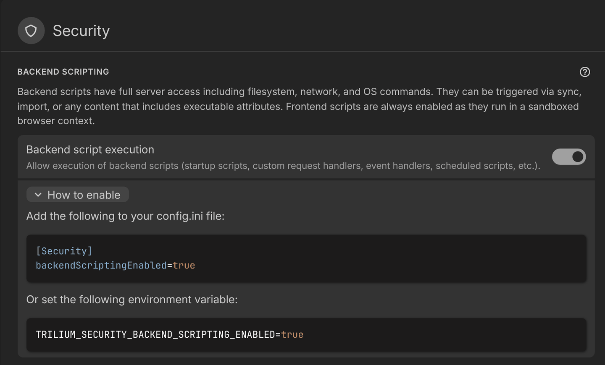
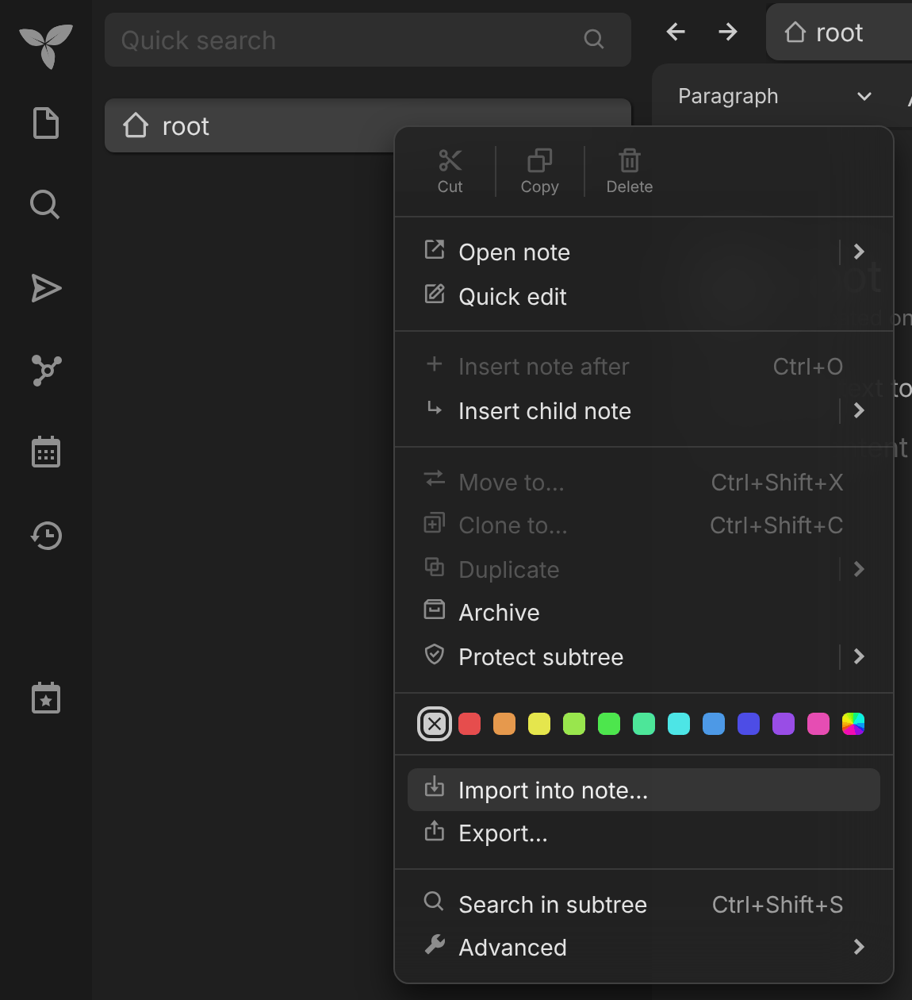
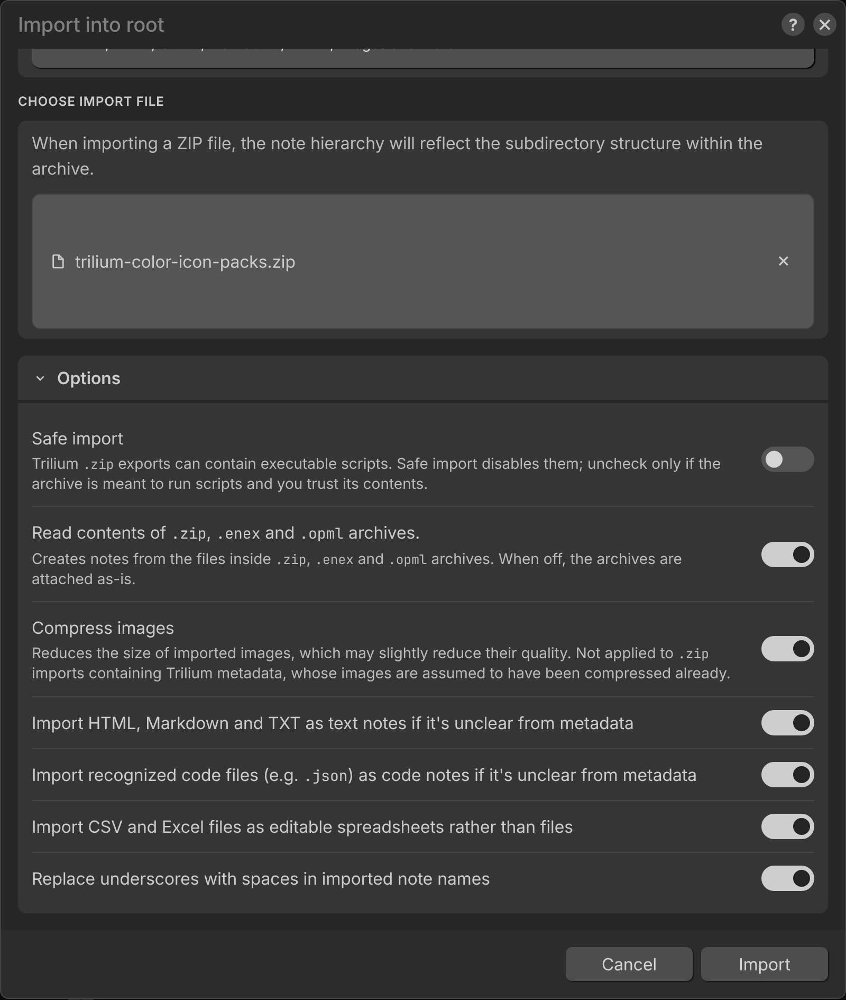
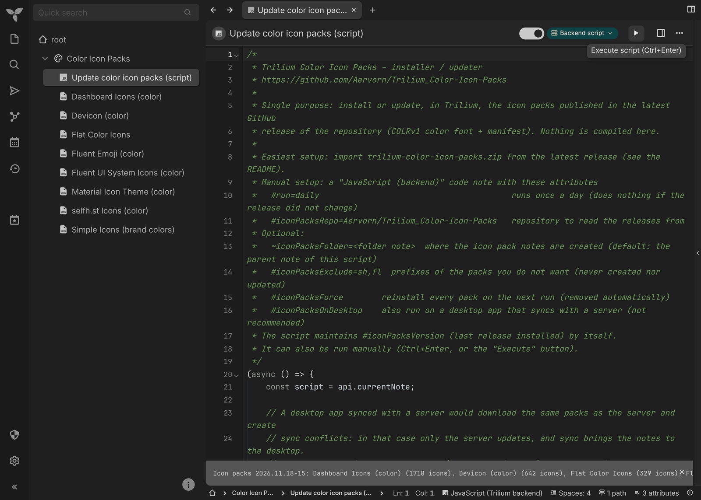

<p align="center"></p>

<p align="center">
  <a href="https://github.com/Aervorn/Trilium_Color-Icon-Packs/releases/latest"></a>
  <a href="https://github.com/TriliumNext/Trilium"></a>
  <a href="#readme"></a>
</p>

<p align="center"><b>English</b> · <a href="README.fr.md">Français</a></p>

**Full-color** icon packs for [Trilium Notes](https://github.com/TriliumNext/Trilium) (v0.102 or later), built every month from eight open-source icon collections (plus an optional pack of your own): **11,300+ icons** for self-hosted apps, brands, programming languages, file types, actions and everyday concepts.

<p align="center"></p>

| Pack | Prefix | Source | What's inside | Icons* | Font size* | License |
| --- | --- | --- | --- | --- | --- | --- |
| selfh.st Icons | `sh` | [selfhst/icons](https://github.com/selfhst/icons) | Logos of self-hosted apps and online services (Docker, Proxmox, Home Assistant, Plex, Nextcloud…) | 2,556 | 940 KB | CC BY 4.0 |
| Devicon | `dev` | [devicons/devicon](https://github.com/devicons/devicon) | Programming languages, frameworks, dev tools (Python, Git, Kubernetes, PostgreSQL…) | 642 | 334 KB | MIT |
| Material Icon Theme | `mat` | [material-extensions/vscode-material-icon-theme](https://github.com/material-extensions/vscode-material-icon-theme) | File types and folders, technical terms (JSON, YAML, logs, certificates, settings…) | 910 | 120 KB | MIT |
| Fluent Emoji | `fl` | [microsoft/fluentui-emoji](https://github.com/microsoft/fluentui-emoji) ("Color" style) | Actions and concepts (rocket, gear, lock, calendar, warning, check mark…) | 1,568 | 1.4 MB | MIT |
| Dashboard Icons | `di` | [homarr-labs/dashboard-icons](https://github.com/homarr-labs/dashboard-icons) | More self-hosted apps, hardware and services, **only those missing from selfh.st** (Synology DSM, TrueNAS, Dockhand…) | 1,710 | 1.3 MB | Apache 2.0 |
| Simple Icons | `si` | [simple-icons/simple-icons](https://github.com/simple-icons/simple-icons) | Brand logos in their brand color: car makers, browsers, banks, hardware, websites (Renault, Firefox, Intel…) | 3,471 | 798 KB | CC0 1.0 |
| Flat Color Icons | `fc` | [icons8/flat-color-icons](https://github.com/icons8/flat-color-icons) | Generic flat icons: office, business, charts, devices (settings, bar chart, money transfer…) | 329 | 40 KB | MIT |
| Fluent UI System Icons | `fs` | [microsoft/fluentui-system-icons](https://github.com/microsoft/fluentui-system-icons) (`_color` variants) | Colored UI symbols (shield, calendar, building, bot, alert…) | 199 | 38 KB | MIT |
| Extra Icons | `ex` | [`custom/`](custom/) folder of this repository | Icons added by hand for what no collection provides. Empty by default: the pack only exists when the folder has icons | – | – | per icon |

\* Release of November 2026. The numbers follow the sources and change from one release to the next.

<a id="contents"></a>

##  Contents

- [Why this exists](#why-this-exists)
- [Requirements and limitations](#requirements-and-limitations)
- [Installation](#installation)
  - [Option A: automatic install and updates (recommended)](#option-a-automatic-install-and-updates-recommended)
  - [Option B: offline archive](#option-b-offline-archive)
  - [Option C: one pack at a time, by hand](#option-c-one-pack-at-a-time-by-hand)
- [Using the icons](#using-the-icons)
- [Updates](#updates)
- [Troubleshooting](#troubleshooting)
- [Uninstalling](#uninstalling)
- [How it works](#how-it-works)
- [Requesting or adding icons](#requesting-or-adding-icons)
- [Building locally, forking, adding a source](#building-locally-forking-adding-a-source)
- [Licenses and credits](#licenses-and-credits)

<a id="why-this-exists"></a>

##  Why this exists

Since v0.102, Trilium supports custom icon packs (see *Icon Packs* in Trilium's built-in help), but only as **fonts** (`woff2`, `woff`, `ttf`). Icon fonts are normally single-color, and Trilium does not accept SVG files or images as icons.

This project compiles the SVG files of each collection into a **COLRv1 color font** with Google's [nanoemoji](https://github.com/googlefonts/nanoemoji). A COLRv1 font is a regular `woff2` file, so Trilium loads it through its official icon pack mechanism: the icons show up in the icon picker, with search and the per-pack filter, in the note tree, tabs and headers, and can be inserted in text notes.

Older workarounds (CSS classes with `background-image`, as in [discussion #4604](https://github.com/orgs/TriliumNext/discussions/4604)) do not appear in the picker and broke with v0.102.

<a id="requirements-and-limitations"></a>

##  Requirements and limitations

- **Trilium v0.102 or later** (custom icon pack support).
- **Color rendering depends on the client.** COLRv1 is supported by Chromium-based browsers (the Trilium desktop app, Chrome, Edge, Opera, Brave…) and by Firefox, but not by Safari (see below).
- **Option A** (automatic updates) needs **backend scripting enabled** (off by default since Trilium v0.104, see [Installation](#option-a-automatic-install-and-updates-recommended)), and the machine that runs the script (your Trilium server, or a standalone desktop app) must reach `github.com` over HTTPS. Option B needs neither.
- **Dark logos on dark themes:** some logos are black (GitHub, Bash, Apple…) and are hard to read on a dark theme. They are drawn exactly as in their source.
- **Skipped icons:** a few SVG files cannot be converted into a font (masks, out-of-range gradients, invalid paths after clipping). They are left out and listed in `<prefix>.skipped.txt` in each release (about 1% of the icons, about 10% for Dashboard Icons).
- **Simple Icons in single color:** Simple Icons logos are drawn in their official brand color. When that color is almost black or almost white (Apple, GitHub, Uber…), the logo uses the **text color of your theme** instead, so it stays readable on light and dark themes.
- **Dashboard Icons as a complement:** to avoid duplicates, the `di` pack only contains the icons that selfh.st does not provide as SVG. Light/dark variants are left out when the base icon exists.
- **Size:** all the fonts weigh about 5 MB together and are loaded by each client. If you only want some of the packs, exclude the others (`#iconPacksExclude`, option A) or delete the notes of the others (option B).

> [!WARNING]
> **Safari does not support COLRv1 color fonts.** In Trilium opened in Safari (macOS, iPhone, iPad), these icons do not show up. Use the Trilium desktop app, or a Chromium-based browser or Firefox.

<a id="installation"></a>

##  Installation

Each release comes with two Trilium archives. Pick one:

| Archive | What you get | Needs |
| --- | --- | --- |
| [`trilium-color-icon-packs.zip`](https://github.com/Aervorn/Trilium_Color-Icon-Packs/releases/latest/download/trilium-color-icon-packs.zip) (**option A**, recommended) | A *Color Icon Packs* folder with a small script that installs the packs, then updates them once a day | Backend scripting enabled, and `github.com` reachable from the Trilium server |
| [`trilium-color-icon-packs-offline.zip`](https://github.com/Aervorn/Trilium_Color-Icon-Packs/releases/latest/download/trilium-color-icon-packs-offline.zip) (**option B**) | A *Color Icon Packs (offline)* folder with every pack, ready to use (~5 MB) | Nothing. No automatic updates: import a newer archive when you want them |

> [!IMPORTANT]
> In the import dialog, **uncheck *Safe import***. Safe import disables the labels that run code or load fonts (`#run`, `#iconPack`), and they would stay inactive as `#disabled:run` / `#disabled:iconPack`. If that already happened, rename those labels to `#run` / `#iconPack`, or delete the folder and import again.

### Option A: automatic install and updates (recommended)

> [!IMPORTANT]
> **With a sync server, do everything on the server:** enable backend scripting there, and import and run the script from the **web interface of the server**. Desktop apps synced with a server skip the script, and sync brings the packs to them.

**1. Enable backend scripting** (once). Since Trilium v0.104 it is off by default, and the update script is a backend script ([Trilium docs](https://docs.triliumnotes.org/user-guide/scripts/Security)). It has to be enabled **where the script runs**: on your server if you have one, otherwise in your desktop app.

- **Desktop app without a sync server:** *Options → Security → Backend script execution*, then restart the app.
- **Server** (Docker or not): the switch cannot be changed from the web interface. *Options → Security → How to enable* shows what to do:
  - Docker: add the environment variable `TRILIUM_SECURITY_BACKEND_SCRIPTING_ENABLED=true` to the container, then recreate it.
  - Otherwise: add `backendScriptingEnabled=true` under `[Security]` in `config.ini` (in the Trilium data directory), then restart Trilium.

  

**2. Download** [`trilium-color-icon-packs.zip`](https://github.com/Aervorn/Trilium_Color-Icon-Packs/releases/latest/download/trilium-color-icon-packs.zip) (about 3 KB: the packs themselves are downloaded by the script).

**3. Import it.** With a sync server, do it in the **web interface of the server**.


- Right-click the note under which you want the folder (`root` is fine) → **Import into note…**

  
- Drop the archive in the dialog, open **Options**, **uncheck *Safe import***, then click **Import**.

  

**4. Run the script once.** Open *Color Icon Packs → Update color icon packs (script)* and click **▶ Execute script** at the top right (or press **Ctrl+Enter**), in the **web interface of the server** too. After a few seconds the eight packs appear in the folder, and a message at the bottom lists what was installed.



**5. Reload Trilium** (**Ctrl+R**, or *Reload frontend* in the menu). The icons are now in the icon picker (see [Using the icons](#using-the-icons)), and the script keeps them up to date by itself, once a day (`#run=daily`).

Notes:
- **With a sync server**, the script runs **on the server only**. Desktop apps synced with a server skip it (to avoid sync conflicts), and sync brings the packs to them. Add `#iconPacksOnDesktop` to the script note to force it to run on desktop apps too (not recommended).
- **Standalone desktop app** (no sync server): the script runs normally in the desktop app.
- **Only some packs:** add `#iconPacksExclude=<prefixes>` to the script note, for example `#iconPacksExclude=si,fc,fs` to leave out Simple Icons, Flat Color Icons and Fluent UI System Icons. Excluded packs are never created nor updated.
- **Another folder for the packs:** add the relation `~iconPacksFolder=<folder note>` to the script note. Without it, the packs go into the script's parent note.
- **From option B to option A:** import the option A archive and run its script. It takes over the packs of the offline archive (wherever they are) and updates them in place.
- **Setting the script up by hand** instead of importing the archive: create a note of type **Code**, language **JavaScript (backend)**, paste [`trilium/update-icon-packs.js`](trilium/update-icon-packs.js), add the labels `#run=daily` and `#iconPacksRepo=Aervorn/Trilium_Color-Icon-Packs`, then continue from step 4. If the note was created by an AI assistant through Trilium's MCP server, `#run` is saved as `#disabled:run`: enable it with the toggle next to the badge beside the note title.

### Option B: offline archive

1. **Download** [`trilium-color-icon-packs-offline.zip`](https://github.com/Aervorn/Trilium_Color-Icon-Packs/releases/latest/download/trilium-color-icon-packs-offline.zip).
2. In Trilium, **right-click a note** → **Import into note** → choose the archive, **uncheck *Safe import*** → *Import* (same dialog as [option A, step 3](#option-a-automatic-install-and-updates-recommended)).
3. **Reload Trilium** (**Ctrl+R**).

To keep only some packs, delete the notes of the others. To update, delete the *Color Icon Packs (offline)* folder and import the archive of a newer release.

### Option C: one pack at a time, by hand

The standard Trilium procedure (see *Creating an icon pack* in Trilium's built-in help), useful for a pack of your own build.

1. Open the [latest release](https://github.com/Aervorn/Trilium_Color-Icon-Packs/releases/latest) and download, for each pack you want, `<prefix>.manifest.json` and `<prefix>.woff2` (prefixes: `sh`, `dev`, `mat`, `fl`, `di`, `si`, `fc`, `fs`, and `ex` when it exists).
2. In Trilium, create a note of type **Code**, language **JSON**, and give it the pack name as title (for example `Fluent Emoji (color)`). The title is shown in the icon picker filter.
3. Paste the content of `<prefix>.manifest.json` into the note.
4. Open the note's **Attachments** and upload `<prefix>.woff2`. Check that the attachment has the MIME type `font/woff2` and the role `file`.
5. Add the label `#iconPack=<prefix>` to the note (for example `#iconPack=fl`).
6. Reload Trilium (**Ctrl+R**).

To update a pack later: replace the note content with the new manifest and the attachment with the new font, then reload.

<a id="using-the-icons"></a>

##  Using the icons


- **Icon picker:** click a note's icon → type a word in the search box. Use the **filter** button next to the search box to show a single pack. Each icon can be found by its name and by the keywords of its source (selfh.st categories and tags, Devicon tags and alternative names, Fluent Emoji keywords, Dashboard Icons aliases and categories, Simple Icons brand names and aliases, Fluent UI System Icons metaphors). The search is not case-sensitive (see the note below).
- **By label:** set `#iconClass="<prefix> <prefix>-<name>"`, for example:
  ```
  #iconClass="sh sh-docker"
  #iconClass="dev dev-python"
  #iconClass="mat mat-json"
  #iconClass="fl fl-rocket"
  #iconClass="di di-synology-dsm"
  #iconClass="si si-firefox"
  #iconClass="fc fc-bar-chart"
  #iconClass="fs fs-shield"
  ```
  The label can be inheritable (`#iconClass(inheritable)=...`) to give the same icon to a whole subtree, as with any Trilium icon.
- **In text notes:** the *Insert icon* button of the formatting toolbar works with these packs too. Note that color fonts ignore the text color.
- **Icon names:**

  | Pack | Name rule | Examples |
  | --- | --- | --- |
  | `sh` | `sh-` + the selfh.st reference (the SVG file name) | `sh-home-assistant`, `sh-adguard-home`, `sh-paperless-ngx` |
  | `dev` | `dev-` + the Devicon name; the colored `original` variant is used, otherwise `plain` | `dev-postgresql`, `dev-nodejs`, `dev-kubernetes` |
  | `mat` | `mat-` + the Material Icon Theme file name | `mat-folder-docker`, `mat-certificate`, `mat-console` |
  | `fl` | `fl-` + the Fluent Emoji name, lowercase, spaces replaced by `-` | `fl-light-bulb`, `fl-check-mark-button`, `fl-hammer-and-wrench` |
  | `di` | `di-` + the Dashboard Icons file name (a `-svg` suffix is removed) | `di-synology-dsm`, `di-truenas`, `di-dockhand` |
  | `si` | `si-` + the Simple Icons slug (brand name, lowercase, letters and digits only) | `si-renault`, `si-googlechrome`, `si-nvidia` |
  | `fc` | `fc-` + the Flat Color Icons file name, `_` replaced by `-` | `fc-settings`, `fc-bar-chart`, `fc-money-transfer` |
  | `fs` | `fs-` + the Fluent UI System Icons name, without size and `_color` suffix, `_` replaced by `-` | `fs-shield`, `fs-calendar`, `fs-building-home` |
  | `ex` | `ex-` + the SVG file name in `custom/` | `ex-remarkable` |

  The full list of a pack is its manifest (`<prefix>.manifest.json` in the release). Names only depend on the sources, so an icon keeps its name from one release to the next. An icon that a source deletes or renames disappears, and the notes using it show no icon.

> [!NOTE]
> **Search and capital letters (Trilium bug).** Trilium lowercases what you type but compares it with the terms of a pack **as they are written**, so a term written `Proxmox` is never found. Since release `2026.11.17-9`, every term of these packs is also listed in lowercase, which works around the bug: if a search finds nothing, update the packs first. The same bug affects any other custom icon pack whose terms contain capitals; a fix has been proposed to Trilium ([TriliumNext/Trilium#12691](https://github.com/TriliumNext/Trilium/pull/12691)).

<a id="updates"></a>

##  Updates

- **Releases:** a GitHub Actions workflow runs on the **1st of each month** (03:23 UTC). It only builds a new release when at least one of the sources changed since the last release.
- **Option A:** the script runs once a day. When the latest release has a new version, it downloads the packs, checks their SHA-256 checksums against `release.json`, updates only the packs that changed and records the installed version in `#iconPacksVersion`. **Reload Trilium** afterwards to load the new fonts.
- **Force a reinstall:** add `#iconPacksForce` to the script note and run it (the label is removed afterwards).
- **Pushes** to the build scripts, to the Trilium script or to the SVG files of `custom/` also build a new release. This is how [requested icons](#requesting-or-adding-icons) are released without waiting for the 1st of the month.
- **Options B and C:** check the [releases](https://github.com/Aervorn/Trilium_Color-Icon-Packs/releases) from time to time, and import the new offline archive (or repeat the manual steps).

<a id="troubleshooting"></a>

##  Troubleshooting

| Symptom | What to check |
| --- | --- |
| The packs do not appear in the icon picker | Reload Trilium (**Ctrl+R**). Check that each pack note has the `#iconPack` label and a `font/woff2` attachment with the role `file`. Protected notes are ignored by Trilium. Look at the backend log (available from the main menu, or in the `log` folder of the Trilium data directory). |
| Icons appear as empty squares or are missing | You are probably using Safari (no COLRv1 support). Try the desktop app, Chrome or Firefox. |
| Right after an update, some icons are blank or wrong on a client (often a desktop app that synced while open) | Reload that client once (**Ctrl+R**): it was still using the previous pack. Since release `2026.11.18-17`, icons keep their code point from one release to the next, so only newly added icons can be missing until the reload. |
| `Backend script execution is disabled` when running the script | Backend scripting is off (default since Trilium v0.104): enable it, see [option A](#option-a-automatic-install-and-updates-recommended), step 1. |
| After an import, the labels read `#disabled:run` or `#disabled:iconPack` | *Safe import* was left checked. Rename the labels to `#run` / `#iconPack`, or delete the folder and import again with *Safe import* unchecked. |
| Log: `Incomplete setup` | The script note lacks `#iconPacksRepo`. |
| Log: `Cannot read the latest release` | The machine running Trilium cannot reach GitHub (firewall, proxy, DNS), or the repository name in `#iconPacksRepo` is wrong. |
| Log: `Desktop app synced with a server` | Expected on a synced desktop app: the server does the update. If you have no server running the script, add `#iconPacksOnDesktop`. |
| Log: `Prefix "xx" is already used by …` | Another icon pack already uses this prefix. The script never overwrites a pack it did not create: rename the other pack's prefix, or remove it. |
| Log: `SHA-256 does not match` | The download was corrupted or interrupted. Nothing was changed; the script tries again on its next run. |
| Log: `Icon packs already up to date` | Nothing to do. Add `#iconPacksForce` to reinstall anyway. |
| The script never runs by itself | Check that the note has `#run=daily` (and not `#disabled:run`), that its language is *JavaScript (backend)*, and that Trilium is not running in safe mode (`TRILIUM_SAFE_MODE`). |
| A search finds nothing, but the icon is in the manifest | Update the packs (release `2026.11.17-9` or later, see *Search and capital letters* above), then reload Trilium. |
| An app has an icon on the source's website, but not in the pack | Some icons cannot be converted: selfh.st offers some apps only as PNG (JDownloader, for example), and some SVG files of Dashboard Icons only wrap a bitmap image. Look for the name in `<prefix>.skipped.txt` of the release, then [request the icon](#requesting-or-adding-icons). Note that `di` leaves out the icons that selfh.st already provides as SVG. |
| Icons of shared notes are missing | For the sharing feature, the icon pack notes must be shared too. |

<a id="uninstalling"></a>

##  Uninstalling

1. Find the notes that use these icons: search `#iconClass =* "sh "` (and the same with `dev `, `mat `, `fl `, `di `, `si `, `fc `, `fs `, `ex `), then change or remove their icon, for example with the *Bulk actions* of the search results.
2. Delete the *Color Icon Packs* folder (or, for a manual setup, the notes with the `#iconPacksManaged` label and the script note), then reload Trilium.

To remove only some packs with option A, add their prefixes to `#iconPacksExclude` on the script note **before** deleting their notes. Otherwise the script recreates any missing pack at the next new release.

<a id="how-it-works"></a>

##  How it works

```
GitHub Actions (1st of each month)                     Trilium (once a day)
 source_revisions.sh  did a source change?              update-icon-packs.js
 fetch_sources.sh     sparse clone of the SVG files      ├─ reads releases/latest/download/release.json
 build_pack.py        COLRv1 font + manifest per pack    ├─ new version? downloads font + manifest
 package_release.py   release.json + SHA-256 checksums   ├─ checks SHA-256
 build_import_zips.py the two Trilium import archives    └─ creates / updates the #iconPack notes
 gh release create
```

- **One job per source**, in parallel (from about 1 minute for Fluent UI System Icons to about 50 minutes for Dashboard Icons).
- **`build_pack.py`** collects the SVG files and their search terms, validates them with picosvg, assigns each icon a code point in the Supplementary Private Use Area-A (U+F0000+) (**stable across releases:** `fetch_previous_manifests.sh` downloads the manifests of the latest release, every icon already published keeps its code point and new icons take the next free ones), compiles the font with nanoemoji (`glyf_colr_1`, 1024 units per em, square glyphs) and converts it to `woff2`. Before that, each SVG is cleaned up: CSS `<style>` rules inlined, `px` units and `transparent` colors removed, viewBox padded to a square so that wide logos stay centered. When nanoemoji fails on some icons, the script finds every failing icon in one pass, removes them and tries again.
- **Release assets**, for each pack: `<prefix>.woff2`, `<prefix>.manifest.json` (Trilium manifest), `<prefix>.skipped.txt`. The two import archives `trilium-color-icon-packs.zip` and `trilium-color-icon-packs-offline.zip`, in the format of a Trilium export (`!!!meta.json`), built by `build_import_zips.py`. Plus `release.json`:
  ```json
  {
    "version": "2026.11.17-7",
    "sources": { "selfhst": "<commit>", "devicon": "<commit>", "material": "<commit>", "fluent": "<commit>", "dashboard": "<commit>", … },
    "packs": [
      { "source": "fluent", "prefix": "fl", "title": "Fluent Emoji (color)", "icons": 1568, "skipped": 27,
        "font": "fl.woff2", "manifest": "fl.manifest.json", "fontSha256": "…", "manifestSha256": "…" }
    ]
  }
  ```
- **Releases** are created as drafts and published only once every asset is uploaded, so a failed upload never becomes the "latest" release.
- **Keeping the schedule alive:** GitHub disables scheduled workflows in public repositories after 60 days without activity. Each run re-enables the workflow through the API, which resets that delay without any commit.

<a id="requesting-or-adding-icons"></a>

##  Requesting or adding icons

Missing icons go in the **Extra Icons** (`ex`) pack, built from the [`custom/`](custom/) folder. There are three ways to get one:

> [!TIP]
> **No need to wait for the monthly build.** When an icon is requested through an issue, I add it and publish a new release as soon as possible. With option A, the script picks it up at its next daily run (or right away if you run it by hand).

| You want | How | Who gets the icon |
| --- | --- | --- |
| An icon for everybody | [Open an icon request](https://github.com/Aervorn/Trilium_Color-Icon-Packs/issues/new?template=icon-request.yml) with a link to the SVG and its license, or open a pull request that adds the SVG to `custom/` (see [`custom/README.md`](custom/README.md)) | Everyone, in a release published as soon as possible |
| Your own icons, kept up to date automatically | Fork this repository, add your SVG files to `custom/` of the fork, and point the Trilium script to the fork with `#iconPacksRepo=<you>/<repo>` | You (your fork publishes its own releases) |
| A one-off test | Build the packs on your machine (next section) and install them by hand (option C) | You, without automatic updates |

Only SVG files that can be redistributed are accepted here: your own drawings, or icons under a license compatible with this repository (MIT, Apache 2.0, CC0, CC BY). The SVG must be a real vector drawing: an SVG that only wraps a PNG or JPEG image cannot become a font glyph.

<a id="building-locally-forking-adding-a-source"></a>

##  Building locally, forking, adding a source

Build one pack on your machine (Python 3.11+):

```bash
pip install -r requirements.txt
bash scripts/fetch_sources.sh src material      # or: selfhst devicon fluent dashboard simpleicons flatcolor fluentsystem extra (no argument = all)
python scripts/build_pack.py material src out   # out/material/: mat.woff2, manifest.json, skipped.txt, pack.json
```

- **Fork:** the workflow works as is in a fork. Point the Trilium script to your fork with `#iconPacksRepo=<you>/<repo>`.

- **Add your own icons:** put SVG files in [`custom/`](custom/), see [`custom/README.md`](custom/README.md). They become the **Extra Icons** (`ex`) pack.
- **Add a source:** write a `collect_<name>()` function in `scripts/build_pack.py` that yields `(name, svg_path, [search terms])`, add it to `PACKS` and `COLLECTORS` with a unique prefix, add its clone to `fetch_sources.sh` and `source_revisions.sh`, and add it to the workflow matrix.
- Issues and pull requests are welcome.

> [!IMPORTANT]
> **Keep a fork public:** the Trilium script downloads the releases without a token. A private fork needs the script to be adapted.

<a id="licenses-and-credits"></a>

##  Licenses and credits

The code of this repository is under the [MIT License](LICENSE). The icons belong to their authors and are redistributed under their own licenses:

- **selfh.st Icons**: © selfh.st, [CC BY 4.0](https://creativecommons.org/licenses/by/4.0/). The icons were converted into a font (format change only).
- **Devicon**: © konpa and contributors, MIT.
- **Material Icon Theme**: © Material Extensions (Philipp Kief and contributors), MIT.
- **Fluent Emoji**: © Microsoft Corporation, MIT.
- **Dashboard Icons**: © homarr-labs and contributors, [Apache 2.0](https://www.apache.org/licenses/LICENSE-2.0).
- **Simple Icons**: [CC0 1.0](https://creativecommons.org/publicdomain/zero/1.0/).
- **Flat Color Icons**: © Icons8, MIT (or the Good Boy License).
- **Fluent UI System Icons**: © Microsoft Corporation, MIT.
- **Extra Icons**: see the licenses table in [`custom/README.md`](custom/README.md).
- **This README:** chapter icons from Fluent Emoji (© Microsoft Corporation, MIT); the banner and screenshots show icons of the packs above.

> [!NOTE]
> **Logos are trademarks.** The brand logos of these packs (selfh.st, Dashboard Icons, Simple Icons, Devicon…) belong to their owners, and their use may be restricted by brand guidelines. The licenses above cover the drawings, not the trademarks.

Brand logos remain the property of their respective owners. This project is not affiliated with TriliumNext or with the authors of the icon collections.
