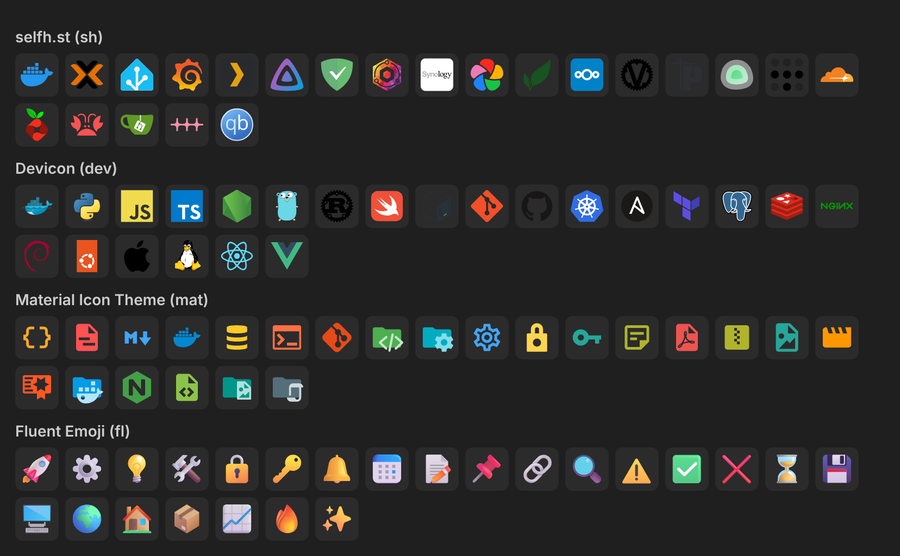

# Trilium Color Icon Packs

**English** · [Français](README.fr.md)

**Full-color** icon packs for [Trilium Notes](https://github.com/TriliumNext/Trilium) (v0.102 or later), built every month from four open-source icon collections: **5,600+ icons** for software, programming languages, file types, actions and everyday concepts.



| Pack | Prefix | Source | What's inside | Icons* | Font size* | License |
| --- | --- | --- | --- | --- | --- | --- |
| selfh.st Icons | `sh` | [selfhst/icons](https://github.com/selfhst/icons) | Logos of self-hosted apps and online services (Docker, Proxmox, Home Assistant, Plex, Nextcloud…) | 2,554 | 940 KB | CC BY 4.0 |
| Devicon | `dev` | [devicons/devicon](https://github.com/devicons/devicon) | Programming languages, frameworks, dev tools (Python, Git, Kubernetes, PostgreSQL…) | 641 | 334 KB | MIT |
| Material Icon Theme | `mat` | [material-extensions/vscode-material-icon-theme](https://github.com/material-extensions/vscode-material-icon-theme) | File types and folders, technical terms (JSON, YAML, logs, certificates, settings…) | 910 | 120 KB | MIT |
| Fluent Emoji | `fl` | [microsoft/fluentui-emoji](https://github.com/microsoft/fluentui-emoji) ("Color" style) | Actions and concepts (rocket, gear, lock, calendar, warning, check mark…) | 1,568 | 1.4 MB | MIT |

\* First release (November 2026). The numbers follow the sources and change from one release to the next.

## Contents

- [Why this exists](#why-this-exists)
- [Requirements and limitations](#requirements-and-limitations)
- [Installation](#installation)
  - [Option A: automatic install and updates (recommended)](#option-a-automatic-install-and-updates-recommended)
  - [Option B: manual install](#option-b-manual-install)
- [Using the icons](#using-the-icons)
- [Updates](#updates)
- [Troubleshooting](#troubleshooting)
- [Uninstalling](#uninstalling)
- [How it works](#how-it-works)
- [Building locally, forking, adding a source](#building-locally-forking-adding-a-source)
- [Licenses and credits](#licenses-and-credits)

## Why this exists

Since v0.102, Trilium supports custom icon packs (see *Icon Packs* in Trilium's built-in help), but only as **fonts** (`woff2`, `woff`, `ttf`). Icon fonts are normally single-color, and Trilium does not accept SVG files or images as icons.

This project compiles the SVG files of each collection into a **COLRv1 color font** with Google's [nanoemoji](https://github.com/googlefonts/nanoemoji). A COLRv1 font is a regular `woff2` file, so Trilium loads it through its official icon pack mechanism: the icons show up in the icon picker, with search and the per-pack filter, in the note tree, tabs and headers, and can be inserted in text notes.

Older workarounds (CSS classes with `background-image`, as in [discussion #4604](https://github.com/orgs/TriliumNext/discussions/4604)) do not appear in the picker and broke with v0.102.

## Requirements and limitations

- **Trilium v0.102 or later** (custom icon pack support).
- **Color rendering depends on the client.** COLRv1 is supported by Chromium-based browsers (the Trilium desktop app, Chrome, Edge, Opera, Brave…) and by Firefox. **Safari does not support COLRv1**: in Trilium opened in Safari (macOS, iPhone, iPad), these icons do not show up.
- **Option A** (automatic updates) needs the machine that runs the script (your Trilium server, or a standalone desktop app) to reach `github.com` over HTTPS.
- **Dark logos on dark themes:** some logos are black (GitHub, Bash, Apple…) and are hard to read on a dark theme. They are drawn exactly as in their source.
- **Skipped icons:** a few SVG files cannot be converted into a font (masks, out-of-range gradients, invalid paths after clipping). They are left out and listed in `<prefix>.skipped.txt` in each release (about 1% of the icons).
- **Size:** the four fonts weigh about 2.8 MB together and are loaded by each client. If you only want some of the packs, exclude the others (`#iconPacksExclude`, option A) or install only those you want (option B).

## Installation

### Option A: automatic install and updates (recommended)

A small backend script, run by Trilium once a day, downloads the latest release, checks it and creates or updates the four icon pack notes. You never have to touch the packs again.

1. **Choose a folder** for the icon packs, for example a note named `Icon packs`. The pack notes will be created inside it.
2. **Create the script note** (anywhere, for example inside that folder): new note → type **Code** → language **JavaScript (backend)**. Paste the content of [`trilium/update-icon-packs.js`](trilium/update-icon-packs.js).
3. **Add these attributes** to the script note (Owned attributes):
   ```
   #run=daily
   #iconPacksRepo=Aervorn/Trilium_Color-Icon-Packs
   ~iconPacksFolder=<the folder from step 1>
   ```
   For the relation, type `~iconPacksFolder=` then pick the folder note in the autocomplete.
4. **Run the script once** right away: open the note and press **Ctrl+Enter** (or the *Execute* button). The script log at the bottom of the note shows what happened, and a message pops up when packs were installed.
5. **Reload Trilium** (**Ctrl+R**, or *Reload frontend* in the menu). The packs are now available in the icon picker.

Notes:
- **With a sync server**, create the script once: it runs **on the server only**. Desktop apps synced with a server skip it (to avoid sync conflicts), and sync brings the packs to them. Add `#iconPacksOnDesktop` to the script note to force it to run on desktop apps too (not recommended).
- **Standalone desktop app** (no sync server): the script runs normally in the desktop app.
- **Only some packs:** add `#iconPacksExclude=<prefixes>` to the script note, for example `#iconPacksExclude=sh,fl` to get only Devicon and Material Icon Theme. Excluded packs are never created nor updated.
- If your note was created by an AI assistant through Trilium's MCP server, `#run` is saved as `#disabled:run`: enable it with the toggle next to the badge beside the note title.

### Option B: manual install

No script and no automatic updates: you install the packs you want by hand, and repeat the steps when you want a newer version. This is the standard Trilium procedure (see *Creating an icon pack* in Trilium's built-in help).

1. Open the [latest release](https://github.com/Aervorn/Trilium_Color-Icon-Packs/releases/latest) and download, for each pack you want, `<prefix>.manifest.json` and `<prefix>.woff2` (prefixes: `sh`, `dev`, `mat`, `fl`).
2. In Trilium, create a note of type **Code**, language **JSON**, and give it the pack name as title (for example `Fluent Emoji (color)`). The title is shown in the icon picker filter.
3. Paste the content of `<prefix>.manifest.json` into the note.
4. Open the note's **Attachments** and upload `<prefix>.woff2`. Check that the attachment has the MIME type `font/woff2` and the role `file`.
5. Add the label `#iconPack=<prefix>` to the note (for example `#iconPack=fl`).
6. Reload Trilium (**Ctrl+R**).

To update a pack later: replace the note content with the new manifest and the attachment with the new font, then reload.

## Using the icons

- **Icon picker:** click a note's icon → type a word in the search box. Use the **filter** button next to the search box to show a single pack. Each icon can be found by its name and by the keywords of its source (selfh.st categories and tags, Devicon tags and alternative names, Fluent Emoji keywords).
- **By label:** set `#iconClass="<prefix> <prefix>-<name>"`, for example:
  ```
  #iconClass="sh sh-docker"
  #iconClass="dev dev-python"
  #iconClass="mat mat-json"
  #iconClass="fl fl-rocket"
  ```
  The label can be inheritable (`#iconClass(inheritable)=...`) to give the same icon to a whole subtree, as with any Trilium icon.
- **In text notes:** the *Insert icon* button of the formatting toolbar works with these packs too. Note that color fonts ignore the text color.
- **Icon names:**

  | Pack | Name rule | Examples |
  | --- | --- | --- |
  | `sh` | `sh-` + the selfh.st reference (the SVG file name) | `sh-home-assistant`, `sh-adguard-home`, `sh-paperless-ngx` |
  | `dev` | `dev-` + the Devicon name; the colored `original` variant is used, otherwise `plain` | `dev-postgresql`, `dev-nodejs`, `dev-kubernetes` |
  | `mat` | `mat-` + the Material Icon Theme file name | `mat-folder-docker`, `mat-certificate`, `mat-console` |
  | `fl` | `fl-` + the Fluent Emoji name, lowercase, spaces replaced by `-` | `fl-light-bulb`, `fl-check-mark-button`, `fl-hammer-and-wrench` |

  The full list of a pack is its manifest (`<prefix>.manifest.json` in the release). Names only depend on the sources, so an icon keeps its name from one release to the next. An icon that a source deletes or renames disappears, and the notes using it show no icon.

## Updates

- **Releases:** a GitHub Actions workflow runs on the **1st of each month** (03:23 UTC). It only builds a new release when at least one of the four sources changed since the last release.
- **Option A:** the script runs once a day. When the latest release has a new version, it downloads the packs, checks their SHA-256 checksums against `release.json`, updates only the packs that changed and records the installed version in `#iconPacksVersion`. **Reload Trilium** afterwards to load the new fonts.
- **Force a reinstall:** add `#iconPacksForce` to the script note and run it (the label is removed afterwards).
- **Option B:** check the [releases](https://github.com/Aervorn/Trilium_Color-Icon-Packs/releases) from time to time and repeat the manual steps.

## Troubleshooting

| Symptom | What to check |
| --- | --- |
| The packs do not appear in the icon picker | Reload Trilium (**Ctrl+R**). Check that each pack note has the `#iconPack` label and a `font/woff2` attachment with the role `file`. Protected notes are ignored by Trilium. Look at the backend log (available from the main menu, or in the `log` folder of the Trilium data directory). |
| Icons appear as empty squares or are missing | You are probably using Safari (no COLRv1 support). Try the desktop app, Chrome or Firefox. |
| Log: `Incomplete setup` | The script note lacks `#iconPacksRepo` or `~iconPacksFolder`. |
| Log: `Cannot read the latest release` | The machine running Trilium cannot reach GitHub (firewall, proxy, DNS), or the repository name in `#iconPacksRepo` is wrong. |
| Log: `Desktop app synced with a server` | Expected on a synced desktop app: the server does the update. If you have no server running the script, add `#iconPacksOnDesktop`. |
| Log: `Prefix "xx" is already used by …` | Another icon pack already uses this prefix. The script never overwrites a pack it did not create: rename the other pack's prefix, or remove it. |
| Log: `SHA-256 does not match` | The download was corrupted or interrupted. Nothing was changed; the script tries again on its next run. |
| Log: `Icon packs already up to date` | Nothing to do. Add `#iconPacksForce` to reinstall anyway. |
| The script never runs by itself | Check that the note has `#run=daily` (and not `#disabled:run`), that its language is *JavaScript (backend)*, and that Trilium is not running in safe mode (`TRILIUM_SAFE_MODE`). |
| Icons of shared notes are missing | For the sharing feature, the icon pack notes must be shared too. |

## Uninstalling

1. Find the notes that use these icons: search `#iconClass =* "sh "` (and the same with `dev `, `mat `, `fl `), then change or remove their icon, for example with the *Bulk actions* of the search results.
2. Delete the pack notes (option A: notes with the `#iconPacksManaged` label) and the script note, then reload Trilium.

To remove only some packs with option A, add their prefixes to `#iconPacksExclude` on the script note **before** deleting their notes. Otherwise the script recreates any missing pack at the next new release.

## How it works

```
GitHub Actions (1st of each month)                     Trilium (once a day)
 source_revisions.sh  did a source change?              update-icon-packs.js
 fetch_sources.sh     sparse clone of the SVG files      ├─ reads releases/latest/download/release.json
 build_pack.py        COLRv1 font + manifest per pack    ├─ new version? downloads font + manifest
 package_release.py   release.json + SHA-256 checksums   ├─ checks SHA-256
 gh release create                                       └─ creates / updates the #iconPack notes
```

- **One job per source**, in parallel (from about 5 minutes for Material to about 25 minutes for selfh.st).
- **`build_pack.py`** collects the SVG files and their search terms, validates them with picosvg, assigns each icon a code point in the Supplementary Private Use Area-A (U+F0000+), compiles the font with nanoemoji (`glyf_colr_1`, 1024 units per em, square glyphs) and converts it to `woff2`. When nanoemoji fails on an icon, the script replays the failing step glyph by glyph to find the culprit, removes it and tries again.
- **Release assets**, for each pack: `<prefix>.woff2`, `<prefix>.manifest.json` (Trilium manifest), `<prefix>.skipped.txt`. Plus `release.json`:
  ```json
  {
    "version": "2026.11.17-7",
    "sources": { "selfhst": "<commit>", "devicon": "<commit>", "material": "<commit>", "fluent": "<commit>" },
    "packs": [
      { "source": "fluent", "prefix": "fl", "title": "Fluent Emoji (color)", "icons": 1568, "skipped": 27,
        "font": "fl.woff2", "manifest": "fl.manifest.json", "fontSha256": "…", "manifestSha256": "…" }
    ]
  }
  ```
- **Releases** are created as drafts and published only once every asset is uploaded, so a failed upload never becomes the "latest" release.
- **Keeping the schedule alive:** GitHub disables scheduled workflows in public repositories after 60 days without activity. Each run re-enables the workflow through the API, which resets that delay without any commit.

## Building locally, forking, adding a source

Build one pack on your machine (Python 3.11+):

```bash
pip install -r requirements.txt
bash scripts/fetch_sources.sh src material      # or: selfhst devicon fluent (no argument = all four)
python scripts/build_pack.py material src out   # out/material/: mat.woff2, manifest.json, skipped.txt, pack.json
```

- **Fork:** the workflow works as is in a fork. Point the Trilium script to your fork with `#iconPacksRepo=<you>/<repo>`. Keep the fork **public** (the script downloads releases without a token) or adapt the script.
- **Add a source:** write a `collect_<name>()` function in `scripts/build_pack.py` that yields `(name, svg_path, [search terms])`, add it to `PACKS` and `COLLECTORS` with a unique prefix, add its clone to `fetch_sources.sh` and `source_revisions.sh`, and add it to the workflow matrix.
- Issues and pull requests are welcome.

## Licenses and credits

The code of this repository is under the [MIT License](LICENSE). The icons belong to their authors and are redistributed under their own licenses:

- **selfh.st Icons**: © selfh.st, [CC BY 4.0](https://creativecommons.org/licenses/by/4.0/). The icons were converted into a font (format change only).
- **Devicon**: © konpa and contributors, MIT.
- **Material Icon Theme**: © Material Extensions (Philipp Kief and contributors), MIT.
- **Fluent Emoji**: © Microsoft Corporation, MIT.

Brand logos remain the property of their respective owners. This project is not affiliated with TriliumNext or with the authors of the icon collections.
